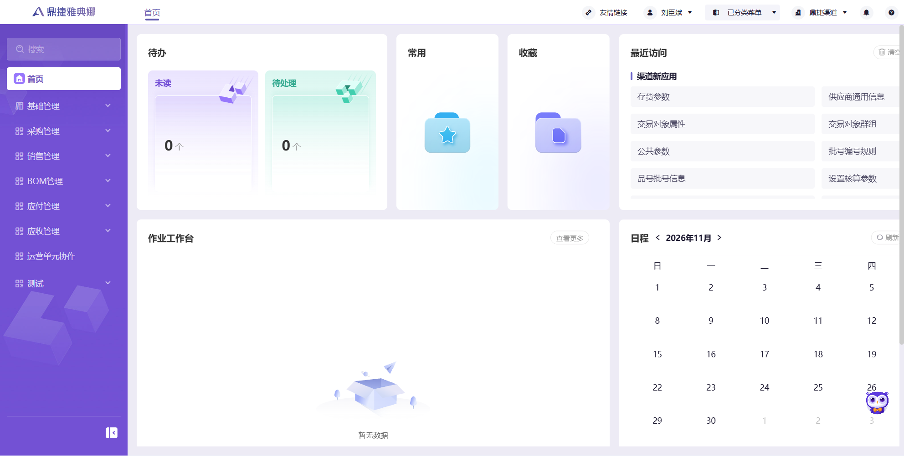
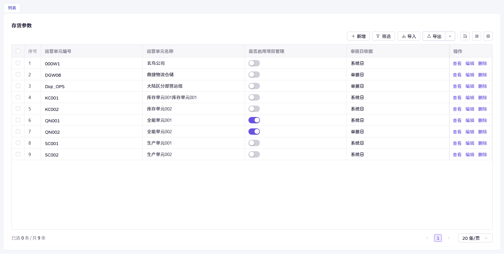
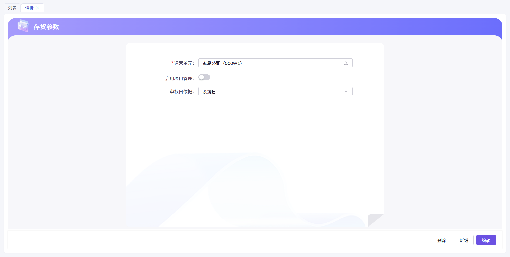
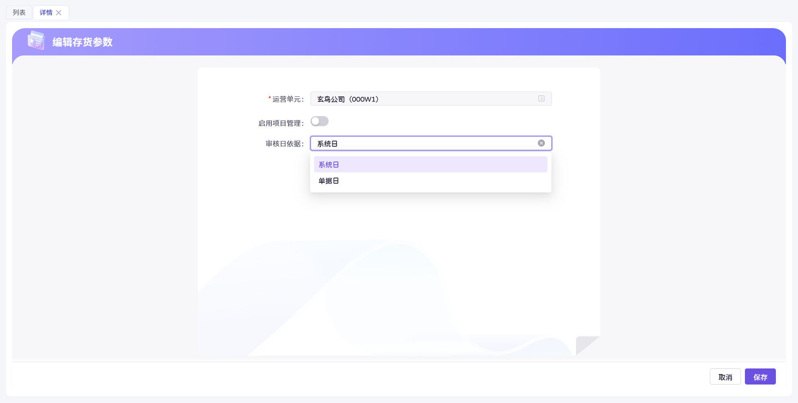
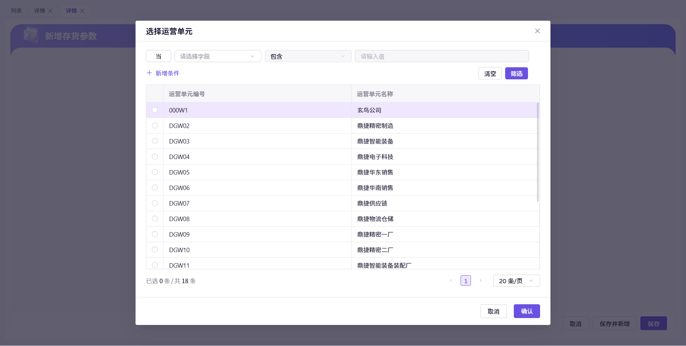

# Phase 0 页面探索报告

环境：`https://athena-test.digiwincloud.com.cn/`　租户：`digichannel`
方式：Chrome CDP 接管 + DOM/元数据采集，全程只读。
产物：`knowledge/athena-page-map.json`、`knowledge/athena-component-map.json`、`knowledge/athena-business-rules.json`

## 1. 页面架构

```
门户（Angular SPA）
  菜单点击 → GET /semc/layout/component/appWork/click → POST /semc/recentAccess/save
           → window.open 低代码业务窗口

业务窗口（React + ag-Grid）
  /?token=...&workItemCode=<页面编码>&applicationCode=smbcloud&tenantId=digichannel
  页面结构与字段来自 queryLatestPageDesignRelease 的 pageDesignInfo
```

关键结论：门户只做入口编排，业务界面完全由低代码元数据驱动；自动化应直接复用业务窗口，不反复点菜单。

## 2. 首页与菜单

- 顶部栏：`#main-header`，含首页页签、友情链接、当前用户、已分类菜单、租户。
- 左侧：`.sider` → `app-tradition-menu` → `ul.menu-list`。
- 菜单节点：`li.level-N` → `div.ant-menu-submenu-title` → `div.menu-content[id]`；叶子节点 id 为递增数字串。
- 规模：9 个顶级、100 个节点。



## 3. 列表页

- 工具栏：`新增 / 筛选 / 导入 / 导出`，均为 `button`，按文本定位。
- 表格：ag-Grid，行 `.ag-row[row-index]`，列 `.ag-cell[col-id]`，表头 `.ag-header-cell[col-id]`。
- 系统列：`$$_checkbox`、`$$_no`、`operate`。
- 行内操作：`button.custom-op-text-btn`（查看 / 编辑 / 删除）。
- 虚拟滚动：DOM 只保留可视行；隐藏行需按 `offsetWidth` 过滤。



**运行期发现**：重复点击已激活的「列表」页签会触发一次空查询（列表变 0 条），刷新后恢复。属于页面行为，不是数据变更。

## 4. 详情与动态表单

- 「查看」打开的是页签（非模态框），标题由 `存货参数` 变为 `查看/编辑` 态。
- 字段容器：`[class*="FormItem-module_form-item__"]`。
- **字段锚点：`label[for="<实体名>.<字段名>"]`**，实体名即表名（如 `ops_unit_invnt_param`）。
- 必填标记：`FormItem-module_form-item-label-required__`。
- 只读态下控件仍渲染，但不可交互；主键字段在编辑态被禁用。



## 5. 下拉与基础资料选择器

**普通下拉**

- 容器 `[class*="Select-module_select__"]`，浮层 `.ath-select-dropdown`。
- 选项 `.ath-select-item-option`，选中态 `.ath-select-item-option-selected`。
- 自定义组件不响应合成事件，需用元素包围盒真实点击。



**基础资料选择器（WindowSelect）**

- 触发：字段右侧图标（容器 `[class*="WindowSelect-module_windowSelect"]`）。
- 弹窗：`.rc-dialog-wrap`，标题「选择运营单元」。
- 结构：筛选行（当 / 字段 / 运算符 / 值 / 新增条件 / 清空 / 筛选）+ ag-Grid + 单选 `input.digi-radio-input` + 页脚「已选 x 条 / 共 y 条」+ 取消 / 确认。
- 只读阶段只允许打开、读取、取消；确认选择会回写表单，未纳入当前用例。
- 查看态不可打开；编辑已存在记录时主键控件禁用，选择器需在新增态验证。



## 6. 页签与未保存守卫

- 业务窗口页签：`.ant-tabs-tab`，关闭按钮 `.ant-tabs-tab-remove`。
- 关闭有未保存内容的页签会弹出：`取消 / 保存并新增 / 保存 / 继续编辑 / 直接离开`。
- 只读流程一律选「直接离开」。

## 7. 字段字典（存货参数，已确认）

实体 `ops_unit_invnt_param`，18 个字段，其中：

| 字段 | 类型 | 控件 | 说明 |
| --- | --- | --- | --- |
| `ops_unit_no` | string | LOOKUP | 主键，编辑态禁用 |
| `ops_unit_name` | string | TEXT | — |
| `aprv_date_basis` | string | DROPDOWN | 1=系统日，2=单据日 |
| `stsp_mgmt` | string | DROPDOWN | 0=不启用，1=启用 |
| `is_ena_proj_mgmt` / `is_stkou_doc_stsp_rqd` / `stkou_doc_save_lot_rqd` | boolean | SWITCH | — |
| `batch_out_whse_desc` / `rmk` | string | TEXT | — |
| `create_by` / `creator_name` / `create_date` / `creat_dept_no` / `creat_dept_name` / `modified_by` / `modifier_name` / `modified_date` | 系统字段 | READONLY | 只读 |

完整字段表见 `knowledge/athena-page-map.json`。

## 8. UNKNOWN 与待确认

| 项 | 状态 | 说明 |
| --- | --- | --- |
| 其余 71 个菜单作业 | UNKNOWN | 仅有菜单名，尚未打开与采集 |
| 编辑态保存行为 | UNKNOWN | 只读阶段未触发保存 |
| 选择器「确认」后的回写与联动 | UNKNOWN | 需在专项用例中验证 |
| 业务规则语义（如审核日依据的实际影响） | CANDIDATE | 已记录为 candidate，待业务确认 |
| 多语言 / 多租户差异 | UNKNOWN | 未验证 |

## 9. 对框架的影响

1. 定位优先级固定为 `label[for]` → 语义属性 → `col-id`/`row-index` → 文本 → 包围盒坐标。
2. 列表页必须等待真实数据行，而不是仅等待页签出现。
3. 详情态与编辑态要区分：只读用例只做识别与取值断言。
4. 关闭页签、切列表等页面状态操作需要幂等，避免重复点击造成空查询。
