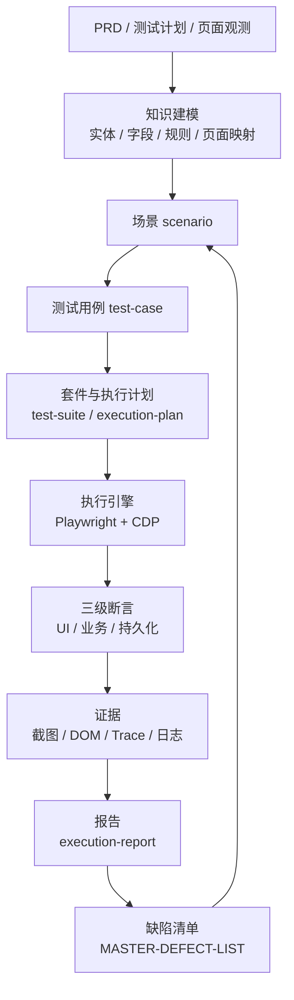

# 整体架构说明

本文是 Athena ERP 自动化测试平台的架构总览：说明系统由哪些层组成、资产放在哪里、一次执行经过哪些环节、哪些约束不可越过。
单项事实以 `docs/architecture/TO-BE.md`、`docs/architecture/BOUNDARIES.md`、`platform/contracts/` 与 `AGENTS.md` 为准；本文负责把它们串成一张图。

## 1. 定位

平台做的是 Athena ERP 的页面级自动化测试：读写真实 UI、按契约组织资产、按分层断言给出结论、按证据链交付报告。

四条设计约束决定了下文所有结构：

1. **默认只读**：写操作是例外，需要运行配置、命令参数与人工授权三者同时成立。
2. **契约先行**：模块、用例、场景、计划、报告都必须先过 Schema 校验，才能被执行引擎消费。
3. **平台与业务分离**：平台核心只建设一次，业务差异全部下沉到模块包。
4. **结论可追溯**：断言必须绑定来源（规则 / PRD / 批准设计），失败必须留证据。

## 2. 全景



左侧是知识来源，中间是资产，右侧是执行与反馈。任何一环都不允许跳过：没有来源的用例不进正式套件，没有断言的用例不算通过，没有证据的失败不算缺陷。

## 3. 三层结构

```text
Platform Core（平台核心）
  ├─ contracts/        18 个 JSON Schema、示例、validator
  ├─ 浏览器/会话/导航    Playwright + CDP 接管
  ├─ 控件与定位          表单 / 表格 / 下拉 / 开窗 / 页签 / 树
  ├─ 执行编排            套件调度、超时、重试安全、只读动作白名单
  ├─ 断言                 ui / business / persistence 三级
  ├─ 证据与报告           截图、DOM、Trace、日志、Markdown/HTML
  └─ 治理                运行配置、版本兼容、动作注册表、门禁

Business Module Packs（业务模块包）
  ├─ base / foundation / purchase / ar / ap
  └─ 每包自带 knowledge / page-mappings / scenarios / testcases /
     data-recipes / test-suites / field-rules / ui-specs

Integration Test Packs（集成测试包）
  └─ purchase-to-ap（骨架，跨模块步骤与断言尚未填充）
```

边界判断规则（引自 `docs/architecture/BOUNDARIES.md`）：

1. 只对某个业务模块成立的逻辑，放该模块包。
2. 只组合多个模块的逻辑，放集成包，且只能引用模块用例，不复制模块内部步骤。
3. 对所有模块都成立的逻辑，才放平台核心。
4. 拿不准时先放模块包，等第二个模块复用时再上提。

## 4. 资产与契约

`platform/contracts/schemas/` 是唯一事实源，当前 18 个 Schema：

| 类别 | Schema | 作用 |
| --- | --- | --- |
| 模块与集成 | `module-manifest`、`integration-pack` | 模块包清单、跨模块包清单 |
| 知识 | `source-index`、`page-mapping`、`field-rule` | PRD 索引、页面字段与控件定位、字段规则集 |
| 用例 | `scenario`、`test-case`、`test-suite`、`execution-plan` | 场景、用例、套件、执行计划 |
| 数据 | `data-recipe` | UI 造数配方、批次与幂等 |
| 运行 | `run-config`、`environment-profile`、`user-profile`、`run-manifest-v2` | 运行配置、环境、操作者、运行清单 |
| 结果 | `execution-report` | 执行报告 |
| 治理 | `action-registry`、`common`、`ui-spec` | 受控动作与风险等级、公共定义、界面规范 |

资产落点：

| 内容 | 位置 |
| --- | --- |
| Schema、示例、validator | `platform/contracts/` |
| 模块清单与业务资产 | `business-modules/<module-id>/` |
| 跨模块步骤、数据映射、断言 | `integration-tests/<integration-id>/` |
| 环境、操作者、运行授权（不含凭据） | `runtime/` |
| 单次运行产物 | `executions/`、`artifacts/<run-id>/` |
| 渲染后的报告 | `reports/runs/` |

契约校验入口：`npm run platform:validate`（全量）、`npm run platform:module -- business-modules/<id>`、`npm run platform:integration -- integration-tests/<id>`、`npm run platform:file -- <file> --schema <name>`。

## 5. 代码分层

`platform/` 目前只有 `contracts/` 落地；其余引擎目录（prd-scanner、knowledge-engine、browser-engine、execution-engine 等）在 `platform/README.md` 中标注为 P2~P5 目标，尚未实质迁移。

当前可运行实现在 `src/`，属于 legacy 位置，按 `docs/upgrade/P0-MIGRATION-PLAN.md` 逐波上提：

| 目录 | 职责 |
| --- | --- |
| `src/browser/` | CDP 与 Chromium 适配、页面管理，不写业务断言 |
| `src/locator/` | 稳定选择器与字段锚点，禁止散落魔法字符串 |
| `src/controls/` | 控件原语，读为主，不提供保存类方法 |
| `src/discovery/` | 页面探索与候选元数据生成，不直接写 confirmed |
| `src/assertion/` | UI / 业务 / 持久化三级断言 |
| `src/evidence/` | 截图、DOM、日志、请求，统一脱敏 |
| `src/reporting/` | Markdown / HTML 渲染，纯函数 |
| `src/runner/` | 只读动作白名单与执行编排 |
| `src/knowledge/` | 知识库加载与结构校验 |
| `src/prd/` | PRD 扫描、证据、关系、Schema 生成 |
| `src/session/`、`src/navigation/` | 会话诊断、登录策略、菜单导航 |
| `src/modules/`、`src/pages/` | 模块专用流程与页面对象（legacy，待迁入模块包） |
| `src/cli/` | 命令行入口（`main`、`platform`、`platform-run`、`platform-plan`、`platform-health`、`platform-ui-spec` 等） |
| `adapters/` | 业务无关的控件适配原语 |

约定：新能力不再往 `src/pages/`、`src/modules/` 堆业务逻辑；模块资产进模块包，通用能力才上提。

## 6. 一次执行的链路

以一条模块用例为例：

1. **入口**：`platform-run.js run --module <id> --case <CASE-ID>`。
2. **门禁**：检查 `ALLOW_ERP_UI_TEST=true`、环境 `type=test`、来源白名单、CDP 可达。
3. **资产校验**：模块清单、用例、页面映射必须符合 Schema；未知字段直接失败。
4. **授权**：读取运行配置的 `safety`，判断本次动作是否在允许集合内；写操作还需 `--allow-write`。
5. **执行**：按用例步骤导航、定位、读取或填写；动作走 `action-registry.json` 的风险等级判定。
6. **断言**：先断言 UI 可观察结果（字段值、按钮状态、行数），再断言业务结果（金额、税额、单据状态），必要时断言持久化（重查、回读）。
7. **证据**：失败自动截图、DOM、控制台、请求与 Trace，写入 `artifacts/<run-id>/`。
8. **报告**：生成 `results.json`、`report.md`、`report.html`；结论区分 UI 成功、业务成功、持久化成功。
9. **缺陷**：按 `docs/defects/MASTER-DEFECT-LIST.md` 编号登记，关联用例、单据号与证据。

不启动浏览器的两条旁路用于验证平台自身：`platform:run:simulate`（占位执行器）与 `platform:plan:dry-run`（场景编译与计划推演）。

## 7. 安全与治理

门禁是链式的，任何一环不满足都拒绝执行：

```text
ALLOW_ERP_UI_TEST=true
  → 环境 type=test 且非生产特征 host
  → 来源在 allowedOrigins 内
  → 运行配置 safety 允许该动作
  → 动作在 action-registry 中且未越级
  → 写操作额外要求 --allow-write 与专用测试数据
```

关键机制：

- **只读动作白名单**：导航、查询、打开记录、读取字段默认可执行；保存、删除、审核、撤审、过账、结账、作废按动作分级，需显式开关。
- **禁止文本**：点击前解析目标文本，命中「保存 / 删除 / 审核 / 反审核 / 结账 / 过账 / 作废」时，只在授权范围内放行。
- **无绝对坐标**：`allowFixedCoordinates=false`；必须点自定义控件时用元素包围盒计算。
- **凭据隔离**：只从环境变量读取，日志、报告、证据统一脱敏。
- **版本门禁**：知识库产物带版本号，`knowledge.expectedModelVersion` 不匹配时拒绝执行。

## 8. 质量门禁与基线

2026-11-18 实测（Windows 11 / Node 24.19.0）：

| 检查 | 命令 | 结果 |
| --- | --- | --- |
| 平台健康 | `npm run platform:health` | required 全通过；`cdp` 可选检查未启动浏览器时为 false |
| 契约校验 | `npm run platform:validate` | 20/20，0 error，2 warning |
| 类型检查 | `npm run typecheck` | 通过 |
| 单元测试 | `npm run test:unit` | 139 passed |
| 契约测试 | `npm run test:contract` | 92 passed |
| 平台自检 | `npm run test:platform` | 94 passed |
| 集成测试 | `npm run test:integration` | 27 passed |

完成标准（`AGENTS.md` §8）：build 无错误、单测全绿、契约测试全绿、`platform:validate` 0 error、新增能力有测试或真实页面证据、文档与知识库同步。

## 9. 模块现状

按目录实际文件统计（2026-11-18，`_template` 不计）：

| 模块 | 版本 | 状态 | 页面映射 | 用例文件 | 字段规则 | UI 规范 |
| --- | --- | --- | ---: | ---: | ---: | ---: |
| purchase | 0.1.0 | draft | 6 | 8 | 1 | 5 |
| foundation | 0.1.0 | draft | 9 | 10 | 9 | 9 |
| base | 0.1.0 | draft | 1 | 2 | 0 | 1 |
| ar | 0.1.0 | draft | 2 | 4 | 0 | 2 |
| ap | 0.1.0 | draft | 2 | 3 | 0 | 2 |

集成包 `purchase-to-ap` 已通过 Schema 校验，但 `steps` 与 `assertions` 为空，尚不可执行。

## 10. 演进与已知缺口

| 缺口 | 影响 | 方向 |
| --- | --- | --- |
| 引擎仍在 `src/`，`platform/` 只有契约 | 平台核心与 legacy 并存，迁移成本累积 | 按 `docs/upgrade/P0-MIGRATION-PLAN.md` 分波上提 |
| 模块全部 draft 0.1.0 | 不能作为正式发布模块 | 逐模块评审升 `reviewed` / `approved` |
| 集成包为空 | 跨模块链路不可执行 | 先填 `purchase-to-ap` |
| 无 CI nightly | 回归依赖人工触发 | 补流水线与定时任务 |
| 知识库产物不入库 | 新克隆仓库缺 `artifacts/knowledge`，dry-run 与版本门禁不可直接复现 | 用 `prd:scan` 重建，或由负责人交付产物 |
| 跨租户未参数化 | 只能跑单租户 `digichannel` | 环境与操作者配置外置后再扩展 |
| 字段级规则覆盖不均 | 基础管理 9 个对象较全，采购仅表头 12 条 | 按 `docs/PHASE3-字段规则校验要求.md` 分批补齐 |

## 11. 文档地图

| 目的 | 路径 |
| --- | --- |
| 快速上手与开启自动化测试 | `docs/ONBOARDING.md` |
| 三层目标结构 | `docs/architecture/TO-BE.md` |
| 平台 / 模块 / 集成边界 | `docs/architecture/BOUNDARIES.md` |
| 契约清单与说明 | `docs/contracts/README.md`、`platform/contracts/` |
| 架构决策 | `docs/decisions/ADR-001-three-layer-architecture.md`、`ADR-002-contract-first.md`、`ADR-003-agent-browser-scope.md` |
| 迁移计划与现状盘点 | `docs/upgrade/P0-MIGRATION-PLAN.md`、`docs/upgrade/P0-AS-IS.md` |
| 业务执行规范 | `docs/自动化测试平台-使用指导说明书.md` |
| 运行手册与配置 | `docs/PHASE2-运行手册.md`、`docs/PHASE2-配置说明.md` |
| 阶段验收 | `docs/acceptance/P1-ACCEPTANCE.md` ~ `P7-ACCEPTANCE.md`、`FINAL-ACCEPTANCE.md` |
| 缺陷总清单 | `docs/defects/MASTER-DEFECT-LIST.md` |
