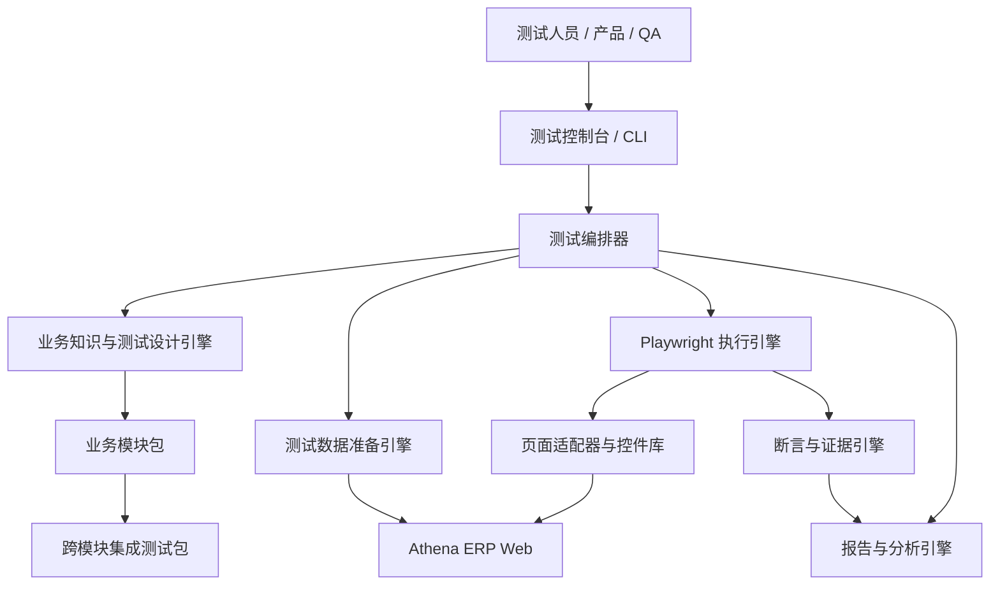

# 02 总体架构与目录规范

## 1. 总体架构



## 2. 三层资产模型

### A. Platform Core（通用平台核心）
- `prd-scanner`：扫描 PRD、提取需求和业务术语。
- `knowledge-engine`：形成实体、字段、规则、流程、状态和关系模型。
- `scenario-engine`：把业务知识转为候选测试场景。
- `testcase-engine`：用例结构、步骤、前置条件、预期结果和断言。
- `dependency-engine`：依赖图、DAG、拓扑排序、循环依赖检测。
- `browser-engine`：Playwright 生命周期、登录态、上下文、截图、trace。
- `page-adapter-engine`：页面对象、控件适配、定位策略和等待策略。
- `data-engine`：测试数据配方、创建顺序、关联键、清理策略。
- `execution-engine`：套件调度、重试、超时、失败传播和并发控制。
- `assertion-engine`：UI 可观察断言、结果采集、证据绑定。
- `report-engine`：报告、趋势、覆盖率和缺陷线索。
- `governance-engine`：审批状态、版本、审计和风险控制。

### B. Business Module Packs（业务模块包）
每个模块只保存业务差异：
- PRD 来源清单及版本；
- 业务知识模型；
- 页面映射；
- 场景和测试用例；
- 数据准备配方；
- 模块测试套件；
- 模块特定断言和适配器扩展（必要时）。

### C. Integration Test Packs（跨模块集成包）
只描述跨模块业务链路与模块包依赖，不复制模块内部页面和用例。例如：
- `purchase-to-ap`：采购订单→到货/入库→应付立账→付款/核销；
- `sales-to-ar`：销售订单→出货/销售出库→应收立账→收款/核销；
- `purchase-to-inventory`：采购入库→库存增加→库存查询；
- `sales-to-inventory`：销售出库→库存减少→库存查询。

以上仅是候选链路，最终流程必须以实际 PRD 和 Athena ERP 页面能力为准。

## 3. 建议仓库目录

```text
Athena-ERP-Automation-Platform/
├── AGENTS.md
├── README.md
├── docs/
│   ├── architecture/
│   ├── contracts/
│   ├── decisions/
│   └── runbooks/
├── platform/
│   ├── prd-scanner/
│   ├── knowledge-engine/
│   ├── scenario-engine/
│   ├── testcase-engine/
│   ├── dependency-engine/
│   ├── browser-engine/
│   ├── page-adapter-engine/
│   ├── data-engine/
│   ├── execution-engine/
│   ├── assertion-engine/
│   ├── report-engine/
│   └── governance-engine/
├── adapters/
│   ├── browser/
│   ├── controls/
│   └── athena-web/
├── business-modules/
│   ├── purchase/
│   │   ├── source-index/
│   │   ├── knowledge/
│   │   ├── page-mappings/
│   │   ├── scenarios/
│   │   ├── testcases/
│   │   ├── data-recipes/
│   │   ├── test-suites/
│   │   ├── fixtures/
│   │   └── module.yaml
│   ├── sales/
│   ├── inventory/
│   ├── ar/
│   ├── ap/
│   └── production/
├── integration-tests/
│   ├── purchase-to-ap/
│   ├── sales-to-ar/
│   ├── purchase-to-inventory/
│   └── sales-to-inventory/
├── runtime/
│   ├── environments/
│   ├── users/
│   └── run-configs/
├── executions/
│   └── .gitkeep
├── reports/
│   └── .gitkeep
├── tools/
├── tests/
│   ├── unit/
│   ├── contract/
│   ├── integration/
│   └── platform/
└── scripts/
```

## 4. 架构边界

| 能力 | 放在哪里 | 禁止事项 |
|---|---|---|
| 通用登录、浏览器上下文 | platform/browser-engine | 不写采购专属逻辑 |
| ERP 菜单与页面定位机制 | adapters/athena-web | 不把某个模块流程硬编码进引擎 |
| 采购单字段与流程 | business-modules/purchase | 不放进 platform |
| 销售订单流程 | business-modules/sales | 不复制采购模块代码后改名 |
| 采购到应付链路 | integration-tests/purchase-to-ap | 不复制全部采购、应付用例 |
| 测试数据创建顺序 | 模块 data-recipes / 集成包组合 | 不直接 SQL 插入 |
| 断言机制 | platform/assertion-engine | 具体业务预期留在模块包 |

## 5. 关键工程组件

平台应通过稳定接口连接各引擎。初期可采用单体仓库、模块化代码，不要过早拆微服务。所有模块资产都必须有 schema 校验和版本号。

建议的运行流程：
1. 解析运行请求；
2. 加载并校验平台、模块包和集成包版本；
3. 检查环境与账号配置；
4. 构建用例依赖 DAG；
5. 计算数据准备计划；
6. 执行数据准备；
7. 执行测试步骤；
8. 采集 UI 断言和证据；
9. 汇总报告；
10. 按清理策略处理测试数据并记录结果。
