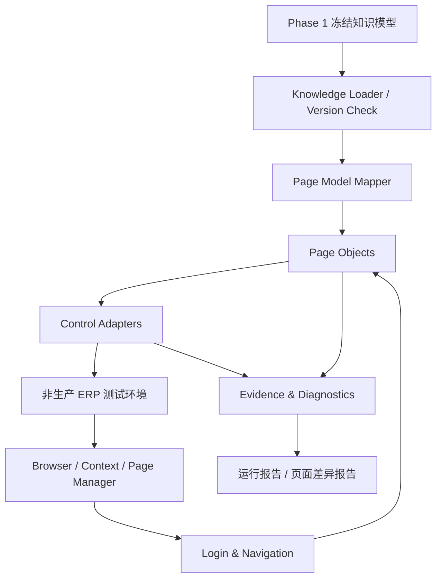

# Phase 2 总体架构

## 1. 定位

Phase 2 建设 ERP UI 自动化底座。它消费 Phase 1 冻结的业务知识模型，并通过 Playwright 与真实 ERP 页面交互。



## 2. 分层职责

| 层 | 职责 | 禁止事项 |
|---|---|---|
| Config | 环境、超时、浏览器、保留策略配置 | 不存放明文凭据 |
| Safety | 环境白名单、生产阻断、高风险动作门禁 | 不允许默认放行 |
| Browser Core | 浏览器/上下文/页面生命周期 | 不承载业务规则 |
| Session | 登录态检测、会话失效处理 | 不绕过 MFA 或安全机制 |
| Navigation | 菜单和页面导航 | 不猜测未验证菜单路径 |
| Adapters | 通用控件交互 | 不写采购业务语义 |
| Page Objects | 采购订单等业务页面封装 | 不直接访问 ERP 后端 |
| Knowledge | 读取 Phase 1 模型、版本检查、页面映射 | 不静默改写冻结模型 |
| Evidence | 截图、Trace、日志、manifest | 不记录密码、Token、敏感值 |
| Diagnostics | 页面侦察、PRD 与实际页面差异 | 不将 DOM 侦察结果当业务规则 |

## 3. 推荐技术栈

- Node.js LTS（使用仓库当前兼容版本；不要无理由升级）
- TypeScript
- Playwright Test 或 Playwright Library（二选一，优先沿用现有项目）
- Zod 或 JSON Schema validator 做配置/数据校验（沿用现有依赖）
- Vitest/Jest/Playwright Test（沿用现有测试框架，避免重复引入）
- JSON/Markdown 作为初期知识与报告格式

## 4. 模块化单体

不拆微服务。通过清晰模块边界和接口降低耦合。

核心接口建议：
- `EnvironmentGuard.assertAllowed()`
- `BrowserManager.launch()`
- `SessionManager.ensureAuthenticated()`
- `NavigationManager.openPage(pageKey)`
- `ControlAdapter` 统一操作契约
- `KnowledgeLoader.loadFrozenModel()`
- `PageModelMapper.compare(expected, observed)`
- `EvidenceManager.captureFailure(context)`

具体类型以实际代码库为准，禁止为追求文档一致而破坏已有实现。

## 5. 关键运行路径

```text
CLI 启动
 → 配置校验
 → 环境安全门禁
 → 创建 runId / run manifest
 → 启动 Browser / Context
 → 登录态检测或登录
 → 导航至目标页面
 → 页面对象调用控件适配器
 → UI 操作
 → 页面可观察结果断言
 → 采集证据
 → 关闭浏览器并生成报告
```

## 6. 与 Phase 1 的边界

Phase 1 是业务规格知识；Phase 2 是实际页面操作能力。Phase 2 不得因为真实页面与 PRD 不一致而直接修改冻结模型。必须输出差异、证据和待决策事项，由业务负责人决定是否修订 Phase 1。
