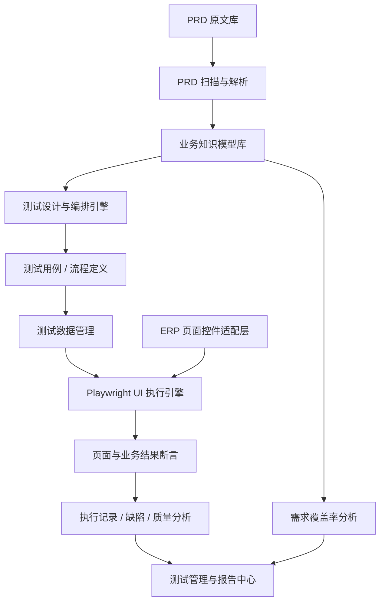

# Athena ERP 全功能业务自动化测试平台——总体架构

版本：V1.0  
架构原则：知识驱动、UI 执行、分层解耦、可追溯、可扩展。

## 1. 建设目标

建设面向 Athena ERP 的全功能业务自动化测试平台，能够从 PRD 中提取业务知识，形成可追溯的测试场景，再通过 Playwright 操作 ERP 页面，完成跨模块业务流程测试、结果断言、异常记录和质量分析。

平台不是“录制回放脚本集合”，而是由业务知识、测试设计、数据管理、UI 自动化和质量报告组成的测试工程系统。

## 2. 总体分层

## 3. 七个核心子系统

### 3.1 PRD 知识建模层（Phase 1，当前优先建设）

职责：
- 递归扫描 PRD 目录。
- 识别文档类型、业务模块、对象、版本、发布日期和状态。
- 解析页面、字段、控件、规则、操作、状态、流程、依赖。
- 将规则和场景关联到原文证据位置。
- 检测文档版本冲突、重复定义、引用缺失和待确认项。
- 输出结构化知识模型、场景草案、覆盖率矩阵和分析报告。

不负责：
- 不连接 ERP。
- 不执行 Playwright。
- 不自动判定 PRD 未说明的业务规则。
- 不把推导规则标成明确规则。

### 3.2 ERP UI 自动化底座（Phase 2）

职责：
- 浏览器启动、连接、会话和登录状态管理。
- 门户导航、菜单定位、页面打开和关闭。
- 控件适配器：Form、Grid、Lookup、Dropdown、TreeSelect、Modal、Toolbar、DatePicker、Tab、分页等。
- 稳定定位策略、等待策略、异常诊断、截图和 Trace。
- 页面元素探索与控件行为记录。

建议技术：
- TypeScript + Playwright。
- Playwright Test 作为测试执行框架。
- Zod 或 JSON Schema 用于运行时数据校验（由 Codex 结合仓库现状决定）。
- Page Object / Component Object 只封装页面操作，不承载业务规则。

### 3.3 测试设计与编排引擎（Phase 3）

职责：
- 从知识模型读取业务规则和场景草案。
- 生成可评审的测试用例。
- 将业务流程拆成步骤、前置条件、数据依赖、操作和断言。
- 支持正向、反向、边界、状态、联动、关联、数量金额、回归、异常恢复场景。
- 场景需保留来源规则 ID 和 PRD 证据引用。
- 需要人工确认的场景进入待评审状态，不得直接执行。

### 3.4 测试数据管理（Phase 4）

职责：
- 测试批次 ID、数据命名规则和数据标签。
- 测试数据依赖图和创建顺序。
- 基础资料、单据数据的 UI 准备策略。
- 数据占用、重复执行和并发隔离。
- 清理策略、逆序清理计划、清理结果记录。
- 对无法安全删除的数据，记录保留原因和人工处理建议。

约束：
- 所有数据准备通过 ERP UI。
- 不得直接写数据库或调用 OpenAPI/MCP 绕过业务页面。
- 删除、撤审、反审核等操作应根据环境和业务状态设置风险确认。

### 3.5 自动化执行引擎（Phase 5）

职责：
- 按测试流程执行 Playwright UI 操作。
- 支持新增、修改、删除、保存、审核、撤审、过账等动作。
- 对每一步记录输入、操作、等待、结果和证据。
- 支持超时、页面异常、弹窗、会话过期等错误分类。
- 重试必须区分幂等操作和非幂等操作；新增、审核、过账等不得无条件重试。
- 支持暂停、继续、中止和失败恢复。

### 3.6 结果验证与质量分析（Phase 5/6）

职责：
- 字段值、列表记录、单据状态、数量金额、上下游引用和流程结果断言。
- 断言必须说明预期值来源：PRD 明确规则、推导规则、平台行为或人工确认。
- UI 不可观察的内部状态不得伪造断言。
- 结果分为通过、失败、阻塞、跳过、待人工确认。
- 汇总需求覆盖率、规则覆盖率、场景覆盖率、执行通过率和缺陷分布。

### 3.7 测试管理与报告中心（Phase 6）

职责：
- 测试计划、批次、执行任务和环境登记。
- 执行日志、截图、Trace、失败步骤和诊断信息。
- PRD 解析报告、覆盖率报告、测试执行报告。
- 历史批次对比、回归趋势和质量看板。
- 导出 Markdown / JSON / HTML 报告。

## 4. 核心数据流

1. PRD 原文进入 `prd/`。
2. 扫描器建立文档登记表。
3. 解析器生成结构化对象。
4. 关联器建立对象、规则、流程和依赖关系。
5. 质量检查器识别冲突、缺失和待确认项。
6. 场景生成器生成测试场景草案。
7. 人工评审后，场景进入可执行用例库。
8. 数据管理器生成 UI 数据准备计划。
9. Playwright 执行器操作 ERP。
10. 断言器检查页面可观察结果。
11. 报告中心汇总结果与证据。

## 5. 关键架构边界

| 边界 | 规则 |
|---|---|
| PRD 解析 vs 测试执行 | 完全解耦；Phase 1 不连接 ERP |
| 业务规则 vs 页面操作 | 业务规则存知识模型；页面操作封装在 UI 控件层 |
| 测试数据 vs 业务执行 | 数据创建和清理也必须走 UI |
| 断言 vs 实现细节 | 只断言 UI 可观察业务结果，不猜测内部服务状态 |
| 自动化 vs 人工确认 | 高风险、规则不明确和不可逆动作需设置确认门 |
| 文档版本 | 每个知识对象必须记录来源文档及版本 |

## 6. 建议技术栈

| 层 | 建议 |
|---|---|
| 主语言 | TypeScript |
| UI 自动化 | Playwright |
| 测试运行 | Playwright Test |
| PRD 解析 | 按文件格式选择解析器；先支持 Markdown，其他格式插件化 |
| 数据契约 | JSON Schema |
| 本地知识库 | JSON 文件为第一阶段默认方案；后续评估 SQLite |
| 报告 | Markdown + JSON；后续 HTML |
| 日志 | 结构化 JSONL |
| 版本控制 | Git |
| 执行环境 | Windows 开发机优先，兼容 CI |

不要为了“架构先进”过早引入微服务、消息队列、向量数据库或独立数据库服务。先用模块化单体和文件型知识库验证闭环。

## 7. 非目标

- 不建设 ERP 生产环境操作机器人。
- 不替代 ERP 本身的业务规则。
- 不通过数据库直写构造测试数据。
- 不在 PRD 不完整时自动补全业务结论。
- 不在 Phase 1 开发完整 UI 自动化执行器。
