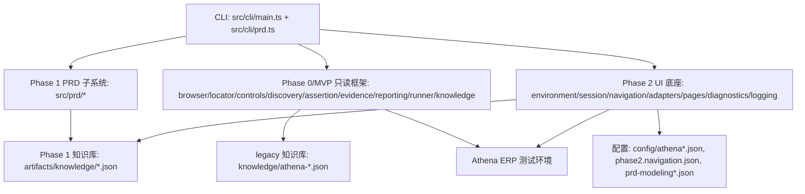

# P0 现状盘点：当前项目真实架构（AS-IS）

> 盘点日期：2026-11-08
> 仓库：`D:\AIProject\ERP-AI-Testing`
> 代码基线：Git `HEAD = 530bfc5`，Phase 2 改动尚未提交
> 盘点方式：只读代码/文档/配置/产物复核；未连接 ERP、未启动浏览器、未执行写操作

## 1. 结论摘要

当前仓库不是一套单一框架，而是三个时期成果叠加的“模块化单体”：

1. **Phase 0 / MVP 只读框架**：CDP/Chromium、页面管理、控件读取、探索、三级断言、证据、Markdown/HTML 报告、只读执行器、legacy 知识库。
2. **Phase 1 PRD 静态建模子系统**：递归扫描、Markdown/平台 JSON 解析、13 类知识对象、证据链、关系、场景草案、校验、报告；不连接 ERP。
3. **Phase 2 UI 自动化底座 + 采购示范**：环境门禁、会话/登录、配置化导航、9 类控件适配器、采购订单/到货/入库/退货页面对象与流程、Trace/manifest、页面侦察与映射；已对真实测试环境执行过受控写入。

三者共享 `src/` 和 `package.json`，但没有统一的平台契约、模块包、集成包或治理层。采购业务逻辑已经进入 CLI、诊断、页面映射、PRD 关系/场景和模块规则等“平台核心”位置，这是升级 v2.0 的首要障碍。

Phase 1 的工程门禁当前可复现通过（`prd:validate` 0 error / 40 warning），但独立语义复验尚未闭环；Phase 2 的 P2.0-P2.3 通过，P2.4 采购链路为“部分通过”，退货审核与退货出库单仍被环境/产品问题阻塞；Phase 3 尚未开始。

## 2. 盘点基线与方法

| 项 | 实测值 |
| --- | --- |
| 操作系统 / Shell | Windows / PowerShell |
| Node.js / npm | v24.19.0 / 11.9.0 |
| TypeScript | 5.9.3，`strict: true`，`target: ES2022`，`module: CommonJS` |
| 测试框架 | `@playwright/test` 1.62.1 |
| JSON Schema | `ajv` 8.x，Draft 2020-12 |
| 源码规模 | `src/` 87 个 `.ts`，15,818 行 |
| 测试规模 | `tests/` 28 个 `.ts`，2,736 行；25 个 unit spec、2 个 integration spec、1 个 smoke spec |
| Git 状态 | `HEAD 530bfc5`；16 个已跟踪文件被修改；206 个未跟踪文件（P0 文档新增前的基线，含 Phase 2 源码、测试、文档、probe 证据） |
| 构建 | `npm run typecheck` 通过；`npm run build` 通过 |
| 单测 / 集成 | `npm run test:unit` 139 passed；`npm run test:integration` 27 passed |
| Phase 1 校验 | `npm run prd:validate -- --json`：`valid=true`，0 error / 40 warning |

盘点命令与结果见 `P0-ACCEPTANCE-REPORT.md` 第 4 节。

## 3. 仓库全景

### 3.1 顶层目录

| 目录/文件 | 内容 | 性质 |
| --- | --- | --- |
| `src/` | 框架、Phase 1、Phase 2 全部 TypeScript 源码 | 产品代码 |
| `tests/` | unit / integration / smoke | 自动化测试 |
| `config/` | 运行时配置、写配置、Phase 2 导航、PRD 建模配置 | 配置 |
| `knowledge/` | legacy 运行时知识库、采购元数据候选、采购前置数据计划 | 知识资产 |
| `schemas/` | Phase 1 知识对象 Schema + Phase 2 配置/manifest/page-mapping Schema | 契约 |
| `cases/` | 只读/写入用例 JSON（存货参数、会计期间表/信息） | 用例资产 |
| `artifacts/` | Phase 1 知识产物、验收报告、Phase 2 证据、会话交付物、按 runId 的执行证据 | 产物/证据（Git 忽略） |
| `reports/` | Phase 1 渲染报告 | 产物 |
| `athena-erp-test-plans/` | 73 份独立作业测试计划、模板、索引 | 规划资产 |
| `docs/` | 架构、运行、探索、PRD 映射、历次开发包与交接文档 | 文档 |
| `probe/` | 探索脚本、抓图、临时诊断、浏览器 profile | 脚手架（profile 不入 Git） |
| `scripts/` | Chrome 启动、PRD Schema 生成、状态调试 | 工具脚本 |
| `skills/athena-erp-testing/` | 项目内 Skill | 开发辅助 |
| `deliverables/` | Phase 1 验收/整改/团队收口 | 交付证据 |
| `.workbuddy/memory/` | 会话记忆与项目索引 | 历史资料 |
| `.archive/` | 旧工作区副本归档 | 归档 |
| `dist/` | `tsc` 编译产物 | 构建产物（Git 忽略） |

### 3.2 当前分层

关键事实：

- **CLI 是最大耦合点**：`src/cli/main.ts` 1,373 行，直接 import 采购订单/到货/入库/退货页面对象与流程，并把 `purchase-order` 作为默认页面。
- **两套知识库并存**：`KnowledgeBase` 只加载 `knowledge/athena-*.json`（8 页面/20 规则/13 控件/19 PRD 条目级别）；`PrdKnowledgeBase` 加载 `artifacts/knowledge/*.json`（13 类/8454 字段/26498 规则）。Phase 2 页面映射消费 Phase 1 知识库，但 legacy 页面冒烟仍消费 legacy 知识库。
- **三套控件交互实现并存**：`src/controls/*`（legacy 只读）、`src/adapters/*`（Phase 2 通用适配器）、`src/pages/purchase/*.page.ts` 与 `write-executor.ts` 中的原始 locator 操作。
- **没有统一执行计划**：Phase 2 的采购流程是 CLI 命令 + 页面对象/flow 的硬编码组合，不是“用例 → 依赖 DAG → 执行计划”的通用调度。

## 4. 代码模块清单

### 4.1 平台/运行时相关

| 模块 | 主要文件 | 职责 | 现状 |
| --- | --- | --- | --- |
| 配置 | `src/config/athena-config.ts`、`config-schema.ts`、`load-env.ts` | 配置解析、Schema 校验、`.env` 加载、环境变量覆盖 | 可用；配置模型仍以单环境为中心 |
| 环境门禁 | `src/environment/environment-guard.ts` | `ALLOW_ERP_UI_TEST`、生产 host 阻断、白名单、重定向检查 | 可用；P2.0 硬门槛已验证 |
| 运行会话 | `src/environment/run-context.ts`、`run-session.ts` | runId、operator、环境、模型版本、code commit、manifest | 可用；manifest 状态仅 4 种 |
| 浏览器 | `src/browser/browser-manager.ts`、`cdp-adapter.ts`、`playwright-adapter.ts`、`context-manager.ts`、`page-manager.ts`、`page-match.ts`、`session.ts` | CDP/Chromium、上下文、页面匹配、列表就绪、状态复位 | 可用；PageManager 内含 Athena 专有 DOM/页签逻辑 |
| 会话/登录 | `src/session/session-manager.ts` | 登录态诊断、manual/form/storage-state 策略、会话失效 | 可用；真实登录失败注入未做 |
| 导航 | `src/navigation/navigation-manager.ts` | 菜单路径、别名归一化、workItemCode、直接会话 token 回退 | 可用；单一 `phase2.navigation.json`，页面键为采购 |
| 控件适配器 | `src/adapters/*` | Input/Button/Dropdown/Date/Lookup/Grid/Tab/Modal/Tree | 可用；9 类，27 个 fixture 集成测试通过 |
| 定位 | `src/locator/strategy.ts`、`athena-profile.ts`、`selectors.ts` | 候选定位、优先级、Athena 选择器 profile | 可用；未强制唯一性，Athena class 仍较多 |
| legacy 控件 | `src/controls/*` | Form/Grid/Lookup/Dropdown/Modal/Tabs 读取原语 | 可用；与 adapters 重复 |
| 探索 | `src/discovery/page-explorer.ts` | 页面 DOM/截图/控件候选采集 | 可用；只产出 candidate |
| 诊断 | `src/diagnostics/failure-collector.ts`、`control-probe.ts`、`page-recon.ts` | 失败证据、控件探测、页面侦察 | 失败采集通用；后两者硬编码采购订单 |
| 断言 | `src/assertion/assertion-engine.ts` | `ui` / `business` / `persistence` 三级断言 | 基础能力可用；缺少来源绑定 |
| 证据 | `src/evidence/evidence-manager.ts`、`trace-manager.ts`、`run-manifest.ts` | 截图、DOM、日志、请求、Trace、manifest、脱敏、保留期 | 可用；已生成 P2 证据 |
| 日志 | `src/logging/console-capture.ts` | console/pageerror 捕获与脱敏 | 可用 |
| 报告 | `src/reporting/types.ts`、`markdown-reporter.ts`、`html-reporter.ts` | Markdown/HTML 运行报告 | 可用；缺少模块/集成分层 |
| 只读执行 | `src/runner/readonly-executor.ts` | 只读动作白名单、步骤执行、断言、证据 | 可用 |
| 写入执行 | `src/runner/write-executor.ts` | 新增/填写/开窗/保存/行操作/删除/清理 DSL | 可用但风险高；动作级授权不足 |
| 安全策略 | `src/runner/safety-policy.ts` | 只读/写入/高风险动作判定、host 白名单 | 有基础；审核存在绕过路径 |
| 列表动作 | `src/runner/actions/master-data-actions.ts` | 筛选、行操作、二次确认删除、行读取 | 可复用；不经过 SafetyPolicy |
| 页面对象 | `src/pages/base/page-object.ts`、`src/pages/purchase/*` | 采购四类单证页面与流程 | 业务实现完整度高，但属于采购模块 |

### 4.2 Phase 1 相关

| 模块 | 主要文件 | 职责 |
| --- | --- | --- |
| 扫描/配置 | `src/prd/scanner.ts`、`config.ts`、`ids.ts` | 递归扫描、SHA-256、稳定 ID、增量状态、模块规则 |
| 解析 | `src/prd/parsers.ts` | Markdown 标题/表格/列表/行号；平台 `prd_spec` JSON |
| 抽取 | `src/prd/extract.ts`（1,680 行） | 文档/实体/页面/字段/控件/规则/动作/流程/依赖/OQ |
| 关联 | `src/prd/link.ts`、`relations.ts` | 版本归并、冲突、覆盖率、单据取单/回写关系 |
| 场景 | `src/prd/scenarios.ts` | 规则 → 场景草案、四类场景族、去重 |
| 校验 | `src/prd/validate.ts` | 手写语义校验 + ajv Schema 校验 |
| 存储/报告 | `src/prd/store.ts`、`reports.ts`、`schema.ts` | 知识库加载、覆盖率、报告渲染 |
| 整改 | `src/prd/remediation.ts` | 从知识库实时复算并登记整改类 OpenQuestion |
| 读取适配 | `src/knowledge/prd-knowledge.ts` | `PrdKnowledgeBase` 只读查询 |
| 版本 | `src/knowledge/model-version.ts` | 13 个知识文件哈希 → `KM-*` 模型版本 |
| CLI | `src/cli/prd.ts` | `scan` / `scan:incremental` / `validate` / `report` / `build` |
| Schema | `schemas/*.schema.json` | 13 类知识对象 + common |

### 4.3 Phase 2 相关

| 模块 | 主要文件 | 职责 |
| --- | --- | --- |
| 环境/运行 | `src/environment/*` | 门禁、runId、manifest |
| 浏览器/会话/导航 | `src/browser/*`、`src/session/*`、`src/navigation/*` | 生命周期、登录态、菜单导航 |
| 控件适配 | `src/adapters/*` | 9 类控件 |
| 页面对象/流程 | `src/pages/purchase/*` | 采购订单、到货、入库、退货 |
| 诊断/侦察 | `src/diagnostics/*` | 失败采集、控件探测、采购订单侦察 |
| 证据 | `src/evidence/*` | 截图、DOM、Trace、manifest |
| 配置/脚本 | `config/athena*.json`、`config/phase2.navigation.json`、`scripts/start-chrome.ps1`、`.env.example` | 环境、导航、浏览器启动 |
| 测试 | `tests/integration/*`、新增 unit spec | 适配器 fixture、失败证据、门禁、manifest |

## 5. 配置、环境与安全基线

### 5.1 配置

| 文件 | 关键内容 | 风险/备注 |
| --- | --- | --- |
| `config/athena.config.json` | 测试环境、CDP 9333、代理、默认只读、禁止动作文本、证据、知识模型版本 | `paths.prd` 是本机绝对路径，已进入 Git；环境值硬编码 |
| `config/athena.write.config.json` | `readOnly=false`、`allowWrite=true`、`allowHighRiskActions=true`、允许删除/审核/撤审/状态变更、禁止结账/过账/作废 | 高风险开关是全局的，不是按用例/按动作授权 |
| `config/phase2.navigation.json` | 采购 5 个页面、菜单路径、workItemCode、业务查询参数 | 页面键为采购；环境 URL 混在导航配置 |
| `config/prd-modeling.config.json` | PRD 目录、扩展名、模块规则、场景来源、输出目录、策略 | 模块规则硬编码采购/应收/应付/财务等 |
| `config/prd-modeling.config.local.json` | 本机 PRD 路径 | 已 Git 忽略 |
| `.env.example` | `ALLOW_ERP_UI_TEST=false`、凭据键名、高风险开关默认 false、CDP/代理/模型版本 | 未提交（当前 untracked） |

### 5.2 安全机制

已具备：

- `ALLOW_ERP_UI_TEST=true` 才能连接 ERP。
- `environment.type=production`、生产特征 host、`blockedOrigins`、白名单外 host、跨主机重定向均拒绝。
- 默认只读配置禁止保存/删除/审核/反审核/结账/过账/作废/提交文本。
- 证据输出统一脱敏 `token/password/passwd/cookie/authorization`。
- run manifest 记录 runId、环境、模型版本、code commit、operator、创建单据、证据、结果。

尚未闭环：

- `SafetyPolicy` 的高风险动作类型是 `delete/audit/unaudit/post/void/status-change`，但 `WriteExecutor` 的 `rowAction` 只按 `row-action` 判定；通过 `rowAction` 点击“审核”不会触发 `allowAudit`。
- 采购页面对象的 `audit()` 直接调用 `MasterDataActions.openRowAction(..., '审核')`，完全不经过 `SafetyPolicy`。
- 写配置下 `readOnly=false`，`click`/`clickButton` 不再做禁止文本检查；点击“审核/提交”可绕过文本门禁。
- `allowFixedCoordinates` 配置存在但代码未使用；`LookupAdapter`/页面对象仍使用元素包围盒偏移点击。
- `browser.retry` 配置存在但执行层未使用；没有动作级重试安全性元数据。
- 没有 per-case/per-run 写授权、审批记录、动作审计流水和清理审计。

## 6. Phase 1 成果盘点

### 6.1 输入与扫描

| 项 | 实测 |
| --- | --- |
| PRD 根目录 | 外部本机目录（配置于 `paths.prd` / `PRD_INPUT_DIR`） |
| 当前 PRD 文件 | 272（246 `.md` + 26 `.json`） |
| 测试用例库 | 268（97 `.md` + 171 `.json`） |
| 扫描总数 | 540；支持 540；不支持 0 |
| 建模文档 | 333（PRD 299 / 用例库 34） |
| 最新版文档 | 47 |
| 解析错误 | 0 |

扫描器已实现：递归、隐藏/临时文件排除、SHA-256、稳定 document ID、`NEW/MODIFIED/UNCHANGED/SOURCE_MISSING`、`.parse-cache`、`DOCUMENT_REGISTER.json`。

### 6.2 知识模型

| 对象 | 数量 |
| --- | ---: |
| Document | 333 |
| Entity | 43 |
| Page | 830 |
| Field / Control | 8,454 / 8,454 |
| Rule | 26,498（最新版 4,050） |
| Action | 1,896 |
| Workflow | 143 |
| Dependency | 850 |
| Scenario | 3,204（全部 DRAFT） |
| ExistingCase | 1,477 |
| OpenQuestion | 620（OPEN 616 / CLOSED 4；HIGH 33） |
| Evidence | 33,510（逐字 33,510） |
| ParseIssue | 0 |

最新版规则来源：`PRD_EXPLICIT` 2,873 / `PRD_DERIVED` 800 / `PLATFORM_SERVICE` 377。

场景可行性：`NEEDS_UI_EXPLORATION` 2,762 / `NEEDS_CONFIRMATION` 314 / `NOT_UI_OBSERVABLE` 128 / `UI_READY` **0**。

依赖：`USES_MASTER_DATA` 347 / `REFERENCES` 489 / `CANDIDATE_LINK` 2 / `DERIVED_FROM` 12；`target_id` 未解析 481 条；12 条 `DERIVED_FROM` 中 5 条有字段级 mapping，7 条为 null。

覆盖率：最新版规则 4,050，已有用例覆盖 822，覆盖率 20.3%；1,477 条用例中 584 条可匹配规则、893 条未匹配。

### 6.3 质量状态

- `prd:validate` 当前为 PASS（0 error / 40 warning），警告只有 `DEPENDENCY_MAPPING_MISSING`、`EVIDENCE_VERSION_UNKNOWN`。
- 独立验收报告（`artifacts/acceptance/PHASE1-ACCEPTANCE-REPORT.md`）结论为“有条件通过”，指出校验器存在语义盲区；开发方随后完成 S-01~S-09 整改并在 `PHASE1-REMEDIATION-R2.md` 中自检通过，但**未发现第三轮独立复验报告**。
- 仍存在：33 条证据无版本、481 条依赖未解析、7 个库存存货域作业缺 PRD、TXT 无真实样本、根级/`_diff` 文档只登记不建模、`rules.json` 约 42 MB 加载成本高。
- 结论：当前知识库可作为“候选/冻结快照”输入，但不宜作为正式用例的唯一业务断言来源，除非完成独立语义抽检和冻结。

## 7. Phase 2 成果盘点

### 7.1 子阶段

| 子阶段 | 内容 | 状态 | 证据 |
| --- | --- | --- | --- |
| P2.0 | 配置 Schema、环境门禁、生产阻断、run manifest、Trace/失败证据 | 通过 | `artifacts/phase2/acceptance/P2.0-ACCEPTANCE-REPORT.md` |
| P2.1 | 浏览器/上下文/会话/登录/导航/列表就绪 | 通过 | `P2.1-ACCEPTANCE-REPORT.md` |
| P2.2 | 9 类控件适配器 + fixture 测试 | 通过 | `P2.2-ACCEPTANCE-REPORT.md` |
| P2.3 | 采购订单页面对象、页面侦察、PRD 字段映射 | 通过（`needs_review`） | `P2.3-ACCEPTANCE-REPORT.md` |
| P2.4 | 采购链路端到端 | 部分通过 | `P2.4-ACCEPTANCE-REPORT.md` |

### 7.2 真实 ERP 验证

- 环境：`athena-test` / `test` / `https://athena-test.digiwincloud.com.cn/`。
- 采购订单菜单导航 5/5 成功；真实新增页 21 个表单项。
- 采购订单：新增、保存、重查、14 项断言、提交、审核通过；至少 PO0501-2026110800001/0002/0003。
- 采购到货单：取单、保存、12 项断言、审核通过。
- 采购入库单：取单、补仓库 00CP、保存、12 项断言、审核通过。
- 采购退货单：创建、保存、14 项断言、提交通过；审核触发自动生成采购退货出库单失败。
- 采购退货出库单：未生成成功，链路未闭环。

### 7.3 页面映射

| 指标 | 数值 |
| --- | ---: |
| PRD 字段 | 102 |
| 页面观察字段 | 32 |
| MATCHED | 29 |
| PRD 有而页面无 | 72 |
| 页面有而 PRD 无 | 2 |
| 控件类型不一致 | 1（`rmk`：PRD LOOKUP / 页面 TEXT_INPUT） |
| 定位器未解析 | 0 |
| 关键字段映射率 | 100%（7/7） |
| 评审状态 | `needs_review` |

### 7.4 阻塞与已知缺陷

- **B1**：退货审核 `bm.pur_rtn_stkou_doc.create` 报“供应商编号 GN-JD-001 不存在或未生效”；主数据页面显示已生效，服务端组合维度不一致。
- **B2**：QN001 单别 PO09 自动编码与后端“不需要输入采购退货单号”校验冲突。
- **DIR-01~DIR-07**：自动生成未传手工单号、取单不接受未审核/审核中退货单、上下游供应商范围不一致、到货发票类型只在财务页签、PO09 自动编码冲突、供应商财务校验滞后、存货业务单别编码方式不可编辑。
- 结论：Phase 2 “整体部分通过，最终放行暂不通过”；不能把 P2.4 写成采购模块验收通过。

### 7.5 交付与工程状态

- `artifacts/phase2/`：00-discovery、01-planning、02-adapters、03-page-mapping、acceptance、最终报告。
- `docs/PHASE2-配置说明.md`、`docs/PHASE2-运行手册.md`。
- `config/athena.write.config.json`、`config/phase2.navigation.json`、`.env.example`。
- 代码/测试/配置/文档均未提交；当前 Git 基线仍是 `530bfc5`。

## 8. Phase 3 成果盘点

**未发现 Phase 3 实现或产物。**

补充证据：用户提供的架构分析共享对话中确实讨论过 Phase 3「测试设计与编排层」开发包（计划包含 `testcase.schema.json`、`execution-plan.schema.json`、P3.0~P3.5 等），但该轮明确说明“本次文件生成未能完成”，且仓库中没有对应 ZIP/MD/代码。因此 Phase 3 只能按“规划态、未交付”处理，不能按已有成果盘点。

没有：

- 场景评审工作流（`DRAFT → REVIEW_REQUIRED → APPROVED/REJECTED`）。
- 场景到结构化用例的编译器。
- 依赖 DAG、拓扑排序、循环依赖检测、失败传播。
- 测试套件编排、Dry-run、执行计划。
- 测试数据配方与数据依赖图。
- 模块包或集成包。

现有可作为 Phase 3 输入的资产：

- Phase 1 的 3,204 条 DRAFT 场景。
- 73 份独立作业测试计划（`athena-erp-test-plans/`）。
- 外部测试用例库 1,477 条记录（97 个 md + 171 个 json）。
- `artifacts/session-outputs/test-cases.v2.schema.json` 与《测试用例结构化数据可用性评估》。
- 一条手工编译样例 `artifacts/session-outputs/TC-PUR-0010.write-case.json`。

## 9. Phase 0 / MVP 成果盘点

- CDP 接管、独立 Chromium、页面匹配、DOM/截图采集、控件识别、只读执行、三级断言、证据、Markdown/HTML 报告。
- `docs/MVP-VALIDATION.md` 记录 6/6 验收项通过。
- `docs/TP-002-VALIDATION.md` 记录 19 个步骤、15 条断言通过。
- `TP-064` / `TP-065` 会计期间表/信息只读执行通过（23/30 条断言）。
- legacy 知识库：`athena-page-map.json`、`athena-component-map.json`、`athena-business-rules.json`、`athena-prd-map.json`、采购元数据候选、采购前置数据计划。
- 该层是 Phase 2 的直接底座，但存在与 Phase 2 重复的控件/知识/用例实现。

## 10. 旧阶段成果映射表

> 处理建议定义：
> **保留** = 基本不改；**适配** = 小改接口/Schema/路径；**迁移** = 换位置/命名空间，行为基本不变；**重构** = 改变内部设计或职责边界；**废弃** = 停止新增使用，迁移完成后处置，不在 P0/P1 删除。
> 文件级映射见 `P0-ASSET-INVENTORY.md`。

| 旧阶段 | 成果/资产 | 关键证据 | 当前状态 | v2.0 归属 | 建议 | 理由 |
| --- | --- | --- | --- | --- | --- | --- |
| Phase 0 | `src/browser/*` | CDP/Chromium、PageManager | 可用 | Platform Core / browser-engine | 适配 | 通用生命周期可复用；Athena 页签/选择器逻辑需下沉到 adapter |
| Phase 0 | `src/locator/*` | 候选定位、AthenaProfile | 可用 | adapters/athena-web + platform locator | 迁移/重构 | 通用策略与 Athena 专有知识需分离 |
| Phase 0 | `src/controls/*` | Form/Grid/Lookup/Dropdown/Modal/Tabs | 可用 | page-adapter-engine（legacy） | 重构/逐步废弃 | 与 adapters 重复；保留到适配器能力对齐 |
| Phase 0 | `src/discovery/*` | candidate 页面元数据 | 可用 | Platform Core / page-adapter-engine | 保留/适配 | 只产出 candidate，符合治理原则 |
| Phase 0 | `src/assertion/*` | 三级断言 | 可用 | Platform Core / assertion-engine | 重构 | 需增加来源、预期值依据、失败分类 |
| Phase 0 | `src/evidence/*` | 截图/DOM/日志/请求/脱敏 | 可用 | Platform Core / evidence | 适配 | 需增加秘密扫描、PII 策略、manifest v2 |
| Phase 0 | `src/reporting/*` | Markdown/HTML | 可用 | Platform Core / report-engine | 重构/适配 | 需模块/集成分层、版本组合、失败分类 |
| Phase 0 | `src/runner/readonly-executor.ts` | 只读动作白名单 | 可用 | execution-engine | 重构 | 迁入统一动作注册表/执行计划 |
| Phase 0 | `src/runner/write-executor.ts` | 写入/清理 DSL | 可用但高风险 | execution-engine | 重构 | 动作级风险/重试/授权/幂等不足 |
| Phase 0 | `src/runner/safety-policy.ts` | 只读/写入/高风险判定 | 有基础 | governance-engine + execution-engine | 重构 | 需堵住审核/rowAction 绕过，按用例授权 |
| Phase 0 | `src/runner/actions/master-data-actions.ts` | 列表筛选/行操作/删除 | 可用 | page-adapter-engine 通用动作 | 重构 | 命名与 toast 文案偏基础资料；需通用化 |
| Phase 0 | `src/knowledge/knowledge-base.ts` | legacy 4 份知识库 | 可用 | knowledge-engine（legacy） | 适配/逐步废弃 | 与 PrdKnowledgeBase 并存，需统一读取 |
| Phase 0 | `knowledge/athena-*.json` | 8 页/20 规则/13 控件/19 PRD 条目 | 可用 | business module packs + legacy knowledge | 迁移 | 页面知识应归模块包；legacy 保留兼容 |
| Phase 0 | `cases/*.json` | 6 个只读/写入用例 | 可用但混合业务 | business modules testcases | 迁移/重构 | 存货/会计期间不属于采购模块；需新用例契约 |
| Phase 1 | `src/prd/scanner.ts`、`parsers.ts`、`config.ts` | 递归/哈希/增量/MD/JSON | 可用 | Platform Core / prd-scanner | 保留/适配 | 扫描能力成熟；模块规则需外置 |
| Phase 1 | `src/prd/extract.ts` | 13 类对象抽取 | 可用 | Platform Core / knowledge-engine | 重构 | 体量大、启发式规则多；需模块化与回归样本 |
| Phase 1 | `src/prd/link.ts`、`relations.ts` | 版本/冲突/关系 | 部分可用 | knowledge-engine | 重构 | 采购单据名硬编码；481 条依赖未解析 |
| Phase 1 | `src/prd/scenarios.ts` | 3,204 DRAFT 场景 | 可用 | Platform Core / scenario-engine | 重构 | 采购节点硬编码；无评审/用例转换 |
| Phase 1 | `src/prd/validate.ts` | 语义 + Schema 校验 | 可用 | knowledge-engine | 保留/适配 | 已有 9 个语义码；仍存语义盲区 |
| Phase 1 | `src/prd/store.ts`、`reports.ts` | 知识加载/报告 | 可用 | knowledge-engine + report-engine | 适配 | 需模块/版本感知；报告口径需统一 |
| Phase 1 | `src/prd/remediation.ts` | 整改 OQ 登记 | 可用 | knowledge-engine/governance | 保留 | 可复算、可追溯 |
| Phase 1 | `src/knowledge/prd-knowledge.ts` | 只读查询适配层 | 可用 | knowledge-engine | 保留/适配 | 下游统一入口；需版本兼容检查 |
| Phase 1 | `src/knowledge/model-version.ts` | `KM-*` 版本 | 可用 | governance-engine | 保留/适配 | 需冻结快照与哈希清单 |
| Phase 1 | `src/cli/prd.ts` | scan/validate/report | 可用 | Platform Core CLI | 适配 | 命令名与只读语义已收口；需模块参数 |
| Phase 1 | `schemas/*.schema.json` | 13 类知识对象 + common | 可用 | docs/contracts 或 platform schemas | 迁移/适配 | 作为知识模型契约；不等于 v2 核心契约 |
| Phase 1 | `artifacts/knowledge/*` | 26,498 规则/33,510 证据 | 可再生产物 | frozen knowledge snapshot | 保留（快照）/迁移 | Git 忽略；需冻结版本与哈希 |
| Phase 1 | `artifacts/source-index/*` | 540 文件登记/增量状态 | 可再生产物 | source-index | 保留/迁移 | 需模块级来源索引 |
| Phase 1 | `reports/*.md` | 12 份报告 | 可再生产物 | report-engine | 保留 | 口径需与新平台统一 |
| Phase 1 | `artifacts/acceptance/*`、`deliverables/*` | 验收/整改/复验 | 历史证据 | docs/acceptance | 保留 | 不作为运行时事实源 |
| Phase 2 | `src/environment/*` | 门禁/runId/manifest | 可用 | Platform Core / governance + runtime | 适配 | manifest 状态/版本需扩展 |
| Phase 2 | `src/session/*` | 登录态/登录策略 | 可用 | Platform Core / browser-engine | 保留/适配 | 需多环境/多账号 profile |
| Phase 2 | `src/navigation/*` | 菜单/别名/直连回退 | 可用 | Platform Core / browser-engine | 重构 | 单一导航文件、采购键、CORS 规避需收敛 |
| Phase 2 | `src/adapters/*` | 9 类控件 | 可用 | Platform Core / page-adapter-engine | 保留/适配 | 需配置驱动、唯一性校验、扩展契约 |
| Phase 2 | `src/pages/base/page-object.ts` | 页面对象基类 | 可用 | page-adapter-engine | 保留 | 通用 |
| Phase 2 | `src/pages/purchase/*` | 采购四类单证页面/flow | 可运行（部分链路） | business-modules/purchase | 迁移/重构 | 业务逻辑必须离开平台核心；大量重复需模板化 |
| Phase 2 | `src/diagnostics/control-probe.ts`、`page-recon.ts` | 采购订单控件/页面侦察 | 可用 | business-modules/purchase/tools | 迁移 | 硬编码 `po.*`、采购 pageKey |
| Phase 2 | `src/cli/main.ts` 采购命令 | create-po/arrival/inbound/return/audit | 可用 | module runner / CLI plugin | 重构/迁移 | 平台 CLI 直接 import 采购页面对象 |
| Phase 2 | `config/phase2.navigation.json` | 采购 5 页导航 | 可用 | business-modules/purchase/page-mappings + runtime env | 迁移/拆分 | 环境参数与模块页面映射混在一起 |
| Phase 2 | `config/athena.write.config.json` | 全局写/高风险开关 | 可用但高风险 | runtime/run-configs | 重构 | 改为 per-run/per-case 授权 |
| Phase 2 | `tests/integration/*` | 适配器 fixture/失败证据 | 可用 | tests/contract / tests/platform | 迁移/适配 | 不是业务集成测试 |
| Phase 2 | `artifacts/phase2/*` | P2 验收/侦察/映射/证据 | 历史证据 | docs/acceptance + executions | 保留 | 不作为运行时事实源；需脱敏/PII 审查 |
| Phase 3 | 共享对话中的 Phase 3 开发包规划（未生成文件） | 架构分析共享对话 | 规划态 | scenario/testcase/dependency/execution | 保留为输入 | 不得当作已交付；仓库无对应产物 |
| Phase 3 | 无实现 | — | 缺失 | scenario/testcase/dependency/execution | 新建 | 必须在 P3-P5 建设 |
| 规划 | `athena-erp-test-plans/*` | 73 份计划 | 规划资产 | business-modules/*/test-plans | 保留/迁移 | 转为模块包测试计划输入 |
| 规划 | 外部测试用例库 | 1,477 条 | 输入资产 | business-modules/*/testcases | 迁移/适配 | 需编译为 v2 TestCase |
| 规划 | `test-cases.v2.schema.json` 评估 | 用例结构评估 | 输入资产 | contracts/testcase | 适配 | 可作为 TestCase 契约参考 |
| 工具 | `scripts/start-chrome.ps1` | Chrome 启动 | 可用 | tools/scripts | 适配 | `--disable-web-security` 需显式风险标记 |
| 工具 | `scripts/generate-prd-schemas.mjs` | Schema 生成 | 可用 | platform schemas tooling | 适配 | 扩展新契约 |
| 文档 | `docs/ARCHITECTURE.md` | 旧技术设计 | 部分过时 | docs/architecture/legacy | 迁移/归档 | 与 Phase 2 文档重复；需单一事实源 |
| 文档 | `docs/PHASE2-*.md`、`MVP-VALIDATION.md`、`PAGE-DISCOVERY-REPORT.md`、`PRD-MAPPING.md` | 运行/探索/映射 | 历史文档 | docs/runbooks、docs/architecture | 迁移/合并 | 大量重复、日期与指标已漂移 |
| 文档 | `DECISIONS.md` D-001/D-002 | 规则/关系判定口径 | 有效 | docs/decisions | 迁移/保留 | 仍是 Phase 1 质量口径 |
| 文档 | `docs/plan/*` 开发包 | v1/v2 指令与规范 | 参考 | docs/plan（冻结） | 保留 | 作为升级依据，不作为运行时 |
| 文档 | `.workbuddy/memory/*` | 会话记忆 | 历史 | docs/legacy/memory | 保留/归档 | 不是权威事实源 |
| 工具 | `probe/*` | 探索/抓图/诊断 | 脚手架 | tools/probe | 保留 | 不进入平台运行时 |
| 辅助 | `skills/athena-erp-testing/*` | 项目 Skill | 可用 | docs/tooling | 适配 | 更新为新架构和边界 |

## 11. 采购逻辑与平台核心的边界问题

| 位置 | 采购耦合 | 影响 | 目标归属 |
| --- | --- | --- | --- |
| `src/cli/main.ts` | import 采购 4 类页面/flow；`purchase-order` 默认页；采购专用命令 | 平台 CLI 无法服务第二模块 | 模块命令/CLI 插件 |
| `src/diagnostics/control-probe.ts` | `po.rmk`、`po.doc_date`、`po.pur_type`、`po.supp_no` | 诊断工具只能用于采购订单 | 模块工具 |
| `src/diagnostics/page-recon.ts` | `pageKey='purchase-order'`、`PAGE-5B4F7C2A66CC`、`po.` 前缀 | 页面侦察不可复用 | 模块工具 |
| `src/knowledge/page-mapper.ts` | 报告标题“采购订单”；`KEY_FIELDS` 为 `po_doc_no/supp_no/...` | 页面映射引擎绑定采购 | 通用映射 + 模块关键字段配置 |
| `src/prd/relations.ts` | `RELATION_DOC_NAMES` 硬编码 7 个采购单据 | 其他模块关系抽取失效 | 模块知识/关系规则 |
| `src/prd/scenarios.ts` | `PURCHASE_NODES` 硬编码采购/应收/应付节点 | 场景族绑定采购 | 模块场景族配置 |
| `src/prd/config.ts` | 模块规则硬编码采购/应收/应付/财务/基础资料 | 新模块需改平台代码 | 模块包配置 |
| `config/phase2.navigation.json` | 5 个采购页面 + 业务查询参数 | 导航配置不可按模块拆分 | 模块 page-mappings + runtime env |
| `src/pages/purchase/*` | 采购页面对象/flows | 业务逻辑在 `src/` 平台树下 | `business-modules/purchase` |
| `knowledge/purchase-*` | 采购元数据候选/前置数据计划 | 采购数据资产散落 | `business-modules/purchase` |
| `athena-erp-test-plans/plans/采购管理-*` | 采购测试计划 | 规划资产散落 | `business-modules/purchase/test-plans` |

## 12. 测试与证据基线

| 测试类型 | 当前内容 | 结果 | 说明 |
| --- | --- | --- | --- |
| Unit | 25 个 spec，139 个测试 | 139 passed | 含 Phase 1 语义/校验、Phase 2 配置/门禁/manifest/导航/会话 |
| Integration | 2 个 spec，27 个测试 | 27 passed | 9 类适配器 fixture + 失败证据 |
| Smoke | 1 个 spec | 未执行 | 需要 CDP 浏览器和业务页 |
| Phase 1 校验 | `prd:validate` | PASS 0 error / 40 warn | 只读；未重扫 |
| 真实 ERP E2E | P2.0-P2.4 | P2.0-P2.3 通过；P2.4 部分通过 | 证据在 `artifacts/phase2/` 与 `artifacts/<runId>/` |

证据目录：

- `artifacts/<run-id>/{manifest.json,shots,dom,traces,logs}`。
- `artifacts/phase2/{00-discovery,01-planning,02-adapters,03-page-mapping,acceptance}`。
- `artifacts/acceptance/` Phase 1 验收/整改。
- `artifacts/session-outputs/` 历史会话交付物与测试用例评估。

## 13. 文档清单与事实源问题

当前与架构/运行相关的文档至少包括：

- `README.md`、`AGENTS.md`、`docs/ARCHITECTURE.md`。
- `docs/BROWSER-CONNECTION.md`、`docs/MVP-VALIDATION.md`、`docs/PAGE-DISCOVERY-REPORT.md`、`docs/PRD-MAPPING.md`、`docs/TODO.md`、`docs/WORKSPACE-HANDOFF-20261106.md`。
- `docs/PHASE2-配置说明.md`、`docs/PHASE2-运行手册.md`。
- `docs/plan/Athena-ERP-Test-Development-Kit/*`（Phase 1 开发包）。
- `docs/plan/Athena-ERP-Phase2-Codex-开发包-v1.0/*`（Phase 2 开发包）。
- `docs/plan/Athena-ERP-Automation-Platform-Upgrade-v2.0/*`（本次升级包）。
- `reports/*.md`、`artifacts/acceptance/*.md`、`deliverables/*.md`、`.workbuddy/memory/*`。

问题：

- 同一事实有多个来源（README、ARCHITECTURE、MVP-VALIDATION、memory），日期/数字不一致。
- Phase 2 运行手册与 README 的“只读”描述冲突：README 仍写“未实现写入型用例”，Phase 2 已实际执行写入。
- Phase 1 完成报告/验收报告/整改报告的知识库批次不同，读者容易误用旧数字。
- 需要 P1 建立 `docs/architecture/`、`docs/contracts/`、`docs/decisions/`、`docs/runbooks/` 的单一事实源，并把旧文档标记为 historical/legacy。

## 14. 未验证项与缺失项

明确记录，不假设存在：

- 未发现 Phase 3 源码、测试、套件、DAG、Dry-run、数据配方。
- 未发现模块包目录或 `module.yaml`。
- 未发现集成测试包目录或 `integration.yaml`。
- 未发现 TestCase / DataRecipe / ExecutionReport / ModuleManifest / IntegrationPack 的正式 Schema。
- 未发现第三轮 Phase 1 独立语义复验报告。
- 未发现 Phase 2 数据清理记录；P2.4 创建的单据默认保留。
- 未执行 `test:smoke`，因为需要真实浏览器/登录态。
- 未对真实 ERP 做任何本次 P0 复核；Phase 2 结论引用既有证据。
- 未读取或打印任何明文密码；`.env` 当前不存在，`.env.example` 未提交。
